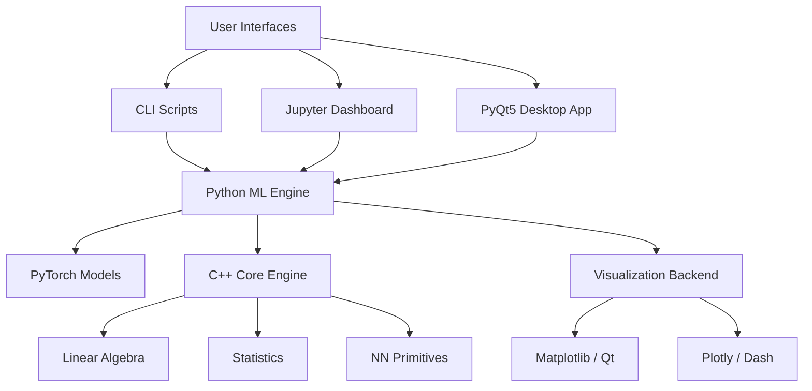

# 🧠 Synapse Lens

> **A production-grade, dual-engine neural network inspection platform.**
> *Real-time weight visualization, gradient flow analysis, and intrusion detection powered by PyTorch and C++.*

[](https://python.org)
[](https://isocpp.org)
[](https://pytorch.org)
[](LICENSE)
[](https://github.com/psf/black)

---

## 🚀 Overview

**Synapse Lens** is a comprehensive toolset designed for researchers and engineers who need deep insights into their models. Unlike standard training loggers, this system provides **real-time, interactive visualization** of internal network states—weights, gradients, activations, and feature maps.

It features a **dual-engine architecture**:
1.  **Python Engine (PyTorch)**: Flexible model definition, training, and data loading.
2.  **C++ Core Engine (Eigen + pybind11)**: High-performance linear algebra, statistical analysis, and custom neural network primitives.

### core Capabilities

| Feature | Description |
|---|---|
| **👀 Interactive Dashboards** | Three interfaces: **Jupyter** (ipywidgets), **Web** (Dash), and **Desktop** (PyQt5). |
| **📉 Gradient Flow** | Visualize gradient magnitude and distribution per layer to diagnose vanishing/exploding gradients. |
| **🔥 Heatmaps & Grids** | See weights and feature maps as heatmaps or image grids in real-time. |
| **🛡️ Intrusion Detection** | Specialized support for NSL-KDD network intrusion detection with tabular anomaly models. |
| **⚡ C++ Acceleration** | Core operations offloaded to optimized C++17 for maximum performance. |
| **📊 Advanced Analysis** | Confusion matrices, classification reports, weight evolution tracking, and JSON experiment export. |

---

## 🏗️ Architecture

The project follows a modular, layered architecture designed for extensibility and performance.



See [ARCHITECTURE.md](ARCHITECTURE.md) for the full technical design document.

---

## � Installation

### Prerequisites
- Python ≥ 3.10
- CMake ≥ 3.20 (for C++ core)
- C++17 compliant compiler (GCC/Clang/MSVC)

### Quick Install (Python only)

```bash
# Clone the repository
git clone https://github.com/your-username/neural-network-visualizer.git
cd neural-network-visualizer

# Install in editable mode with all dependencies
pip install -e ".[dev]"
```

### Build C++ Core (Recommended)

For maximum performance, build the C++ acceleration layer:

```bash
mkdir build && cd build
cmake .. -DCMAKE_BUILD_TYPE=Release
cmake --build . --config Release
cd ..
```

---

## 🚦 Usage

### 1. Desktop GUI (PyQt5)
The most powerful interface, featuring a tabbed MVC design for training, visualization, and model comparison.

```bash
# Launch the standalone GUI
python -m nnviz.gui.main_window
```

### 2. Jupyter Dashboard
Interactive notebook integration with `ipywidgets`.

```bash
# Start Jupyter
jupyter notebook notebooks/experiment_dashboard.ipynb
```

### 3. CLI Experiments
Run reproducible experiments defined in YAML configuration files.

```bash
# Train MLP on MNIST (Default)
python scripts/train.py

# Run Network Intrusion Detection Experiment
python scripts/train.py --config configs/intrusion_experiment.yaml

# Visualize Results
python scripts/visualize.py --model checkpoints/best_model.pt
```

### 4. Comparison Dashboard
Compare multiple architectures (e.g., MLP vs. CNN vs. AnomalyMLP).

```bash
# Generate comparison report
python -m nnviz.analysis.compare_architectures --models mlp,cnn,anomaly_mlp
```

---

## 📊 Features in Detail

### 🔍 Weight & Gradient Analysis
- **Weight Evolution**: Track how weight distributions change over epochs (mean, std, L2 norm).
- **Gradient Histograms**: Detect dead neurons or saturating gradients instantly.

### �️ Network Intrusion Detection
- Built-in support for **NSL-KDD** and synthetic intrusion datasets.
- **AnomalyMLP**: specialized architecture with Batch Normalization for tabular anomaly detection.
- **Confusion Matrix**: Real-time evaluation of detection performance (Normal, DoS, Probe, R2L, U2R).

### ⚡ C++ Core Engine
- **`Matrix`**: Custom high-performance matrix class with operator overloading.
- **`DenseLayer`**: Optimized forward/backward propagation.
- **`Loss`**: Numerical stable MSE and Cross-Entropy implementations.
- **Bindings**: Seamless Python integration via `pybind11`.

---

## 🤝 Contributing

We welcome contributions! Please see [CONTRIBUTING.md](CONTRIBUTING.md) for details on:
- 🛠️ Setting up the dev environment
- 🧪 Running tests (Python + C++)
- 🎨 Code style guidelines

---

## � License

This project is licensed under the MIT License - see the [LICENSE](LICENSE) file for details.

---

## 🔒 Security

For security vulnerability reporting, please refer to [SECURITY.md](SECURITY.md).

---

<div align="center">

</div>
